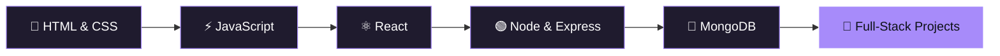

<!-- ═══════════════════════ HERO ═══════════════════════ -->
<p align="center">
  
</p>

<p align="center">
  <a href="https://github.com/AbdulRaqeebGit">
    
  </a>
</p>

<p align="center">
  
  
  
  
</p>

<p align="center">
  <a href="#-about-me">About</a> &nbsp;•&nbsp;
  <a href="#-tech-stack">Stack</a> &nbsp;•&nbsp;
  <a href="#-featured-projects">Projects</a> &nbsp;•&nbsp;
  <a href="#-my-journey">Journey</a> &nbsp;•&nbsp;
  <a href="#-github-analytics">Stats</a> &nbsp;•&nbsp;
  <a href="#-lets-connect">Connect</a>
</p>

<br/>

<!-- ═══════════════════════ ABOUT ═══════════════════════ -->
## 🧑‍💻 About Me

<table>
<tr>
<td width="55%" valign="top">

I'm a **frontend developer** who loves the moment an idea on paper becomes something people can *click, scroll and feel*.

- 🎨 Obsessed with **clean UI** & modern design
- 📱 Every layout I build is **fully responsive**
- ⚙️ Leveling up into the **MERN stack**
- 🧪 I learn by **building** — projects over tutorials
- 🤝 Always open to **collaboration** & fresh ideas

> [!TIP]
> Got an idea or a project? Let's build something awesome together.

</td>
<td width="45%" valign="top">

```js
const abdulRaqeeb = {
  role: "Frontend Developer",
  location: "Pakistan 🇵🇰",
  focus: ["Clean UI", "Responsive", "UX"],
  learning: ["React", "Node.js", "MongoDB"],
  building: "Real-world projects",
  fuel: ["☕ Coffee", "🎧 Music", "💡 Curiosity"],

  motto() {
    return "Consistency over perfection.";
  },
};
```

</td>
</tr>
</table>

<br/>

<!-- ═══════════════════════ TECH STACK ═══════════════════════ -->
## ⚡ Tech Stack

<p align="center"><b>🎯 Frontend</b></p>
<p align="center">
  
  
  
  
  
  
</p>

<p align="center"><b>🛠️ Backend & Database</b></p>
<p align="center">
  
  
  
</p>

<p align="center"><b>🧰 Tools</b></p>
<p align="center">
  
  
  
</p>

<br/>

<!-- ═══════════════════════ PROJECTS ═══════════════════════ -->
## 🚀 Featured Projects

<!--
  👉 Replace YOUR_REPO_1 / YOUR_REPO_2 / ... with your real repository names.
-->

<p align="center">
  <a href="https://github.com/AbdulRaqeebGit/YOUR_REPO_1">
    
  </a>
  <a href="https://github.com/AbdulRaqeebGit/YOUR_REPO_2">
    
  </a>
</p>
<p align="center">
  <a href="https://github.com/AbdulRaqeebGit/YOUR_REPO_3">
    
  </a>
  <a href="https://github.com/AbdulRaqeebGit/YOUR_REPO_4">
    
  </a>
</p>

<br/>

<!-- ═══════════════════════ JOURNEY ═══════════════════════ -->
## 🗺️ My Journey



<details>
<summary><b>🎯 My 2026 goals (click to expand)</b></summary>
<br/>

- [x] Build a strong foundation in HTML, CSS & JavaScript
- [ ] Master React and component-driven design
- [ ] Build & ship 5 real-world projects
- [ ] Learn backend with Node.js, Express & MongoDB
- [ ] Contribute to open-source
- [ ] Code consistently, every single day

</details>

<br/>

<!-- ═══════════════════════ STATS ═══════════════════════ -->
## 📊 GitHub Analytics

<p align="center">
  
  
</p>

<p align="center">
  
</p>

<p align="center">
  
</p>

<p align="center">
  
</p>

<!-- 🐍 Snake animation: works only after you add the snake.yml workflow (see instructions). -->
<p align="center">
  <picture>
    <source media="(prefers-color-scheme: dark)" srcset="https://raw.githubusercontent.com/AbdulRaqeebGit/AbdulRaqeebGit/output/github-contribution-grid-snake-dark.svg" />
    <source media="(prefers-color-scheme: light)" srcset="https://raw.githubusercontent.com/AbdulRaqeebGit/AbdulRaqeebGit/output/github-contribution-grid-snake.svg" />
    
  </picture>
</p>

<br/>

<!-- ═══════════════════════ QUOTE ═══════════════════════ -->
<p align="center">
  
</p>

<br/>

<!-- ═══════════════════════ CONNECT ═══════════════════════ -->
## 🌐 Let's Connect

Have an idea, a project, or something interesting to share? My inbox (and DMs) are open.

<p align="center">
  <a href="https://linkedin.com/in/abdul-raqeeb-5908a931a">
    
  </a>
  <a href="https://instagram.com/a_raqeebofficial">
    
  </a>
  <a href="https://github.com/AbdulRaqeebGit">
    
  </a>
</p>

<p align="center">
  
</p>

<p align="center">
  
</p>
