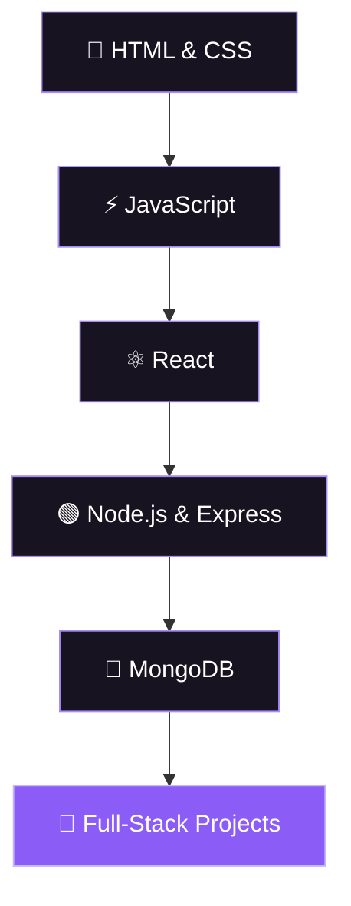

<!-- ═══════════════════ ANIMATED HEADER ═══════════════════ -->

<p align="center">
  
</p>

<p align="center">
  <a href="https://github.com/AbdulRaqeebGit">
    
  </a>
</p>

<p align="center">
  <a href="https://github.com/AbdulRaqeebGit?tab=repositories">
    
  </a>
  <a href="https://linkedin.com/in/abdul-raqeeb-5908a931a">
    
  </a>
</p>

<p align="center">
  
  
</p>

---

<!-- ═══════════════════ ABOUT ME ═══════════════════ -->

<h2 align="center">✦ &nbsp; ABOUT ME &nbsp; ✦</h2>

<p align="center">
  <i>Creating meaningful digital experiences, one line of code at a time.</i>
</p>

```js
const abdulRaqeeb = {
  name: "Abdul Raqeeb",
  username: "AbdulRaqeebGit",
  role: "Frontend Developer",
  location: "Pakistan 🇵🇰",

  interests: [
    "Web Development",
    "Creative UI Design",
    "Responsive Websites"
  ],

  learning: [
    "JavaScript",
    "React",
    "Node.js",
    "MongoDB"
  ],

  mindset: "Learn by building",
  goal: "Turn ideas into real-world projects"
};
```

- 🎨 I enjoy creating clean, modern user interfaces.
- 💻 I build responsive and interactive web experiences.
- 🌱 I am continuously improving my development skills.
- 🚀 I enjoy experimenting with ideas and building projects.
- 🤝 Always interested in learning and collaborating.

---

<!-- ═══════════════════ TECH STACK ═══════════════════ -->

<h2 align="center">⚡ &nbsp; TECH STACK</h2>

<p align="center">
  <b>FRONTEND DEVELOPMENT</b>
  <br/><br/>
  
</p>

<p align="center">
  <b>BACKEND & DATABASE</b>
  <br/><br/>
  
</p>

<p align="center">
  <b>DEVELOPMENT TOOLS</b>
  <br/><br/>
  
</p>

---

<!-- ═══════════════════ PROJECTS ═══════════════════ -->

<h2 align="center">🚀 &nbsp; PROJECTS & EXPLORATION</h2>

<p align="center">
  
  
</p>

<p align="center">
  Discover my repositories, experiments, and latest work.
</p>

<p align="center">
  <a href="https://github.com/AbdulRaqeebGit?tab=repositories">
    
  </a>
</p>

---

<!-- ═══════════════════ JOURNEY ═══════════════════ -->

<h2 align="center">🗺️ &nbsp; MY DEVELOPMENT JOURNEY</h2>



<details>
  <summary><b>🎯 My Development Goals</b></summary>

  <br/>

  - [x] Build a foundation in HTML and CSS
  - [x] Start building JavaScript projects
  - [ ] Improve JavaScript problem-solving
  - [ ] Build more projects with React
  - [ ] Develop backend applications
  - [ ] Create and deploy full-stack projects

</details>

---

<!-- ═══════════════════ GITHUB ANALYTICS ═══════════════════ -->

<h2 align="center">📊 &nbsp; GITHUB ANALYTICS</h2>

<p align="center">
  
  
</p>

<p align="center">
  
</p>

<p align="center">
  
</p>

---

<!-- ═══════════════════ CONTRIBUTION SNAKE ═══════════════════ -->

<h2 align="center">🐍 &nbsp; CONTRIBUTION JOURNEY</h2>

<p align="center">
  <i>Every contribution is another step forward.</i>
</p>

<p align="center">
  <picture>
    <source media="(prefers-color-scheme: dark)" srcset="https://raw.githubusercontent.com/AbdulRaqeebGit/AbdulRaqeebGit/output/github-contribution-grid-snake-dark.svg"/>
    <source media="(prefers-color-scheme: light)" srcset="https://raw.githubusercontent.com/AbdulRaqeebGit/AbdulRaqeebGit/output/github-contribution-grid-snake.svg"/>
    
  </picture>
</p>

---

<!-- ═══════════════════ TROPHIES ═══════════════════ -->

<h2 align="center">🏆 &nbsp; GITHUB ACHIEVEMENTS</h2>

<p align="center">
  
</p>

---

<!-- ═══════════════════ CONNECT ═══════════════════ -->

<h2 align="center">🌐 &nbsp; LET'S CONNECT</h2>

<p align="center">
  <i>Have an idea, a project, or something interesting to share?</i>
  <br/>
  <i>Let's connect and create something meaningful.</i>
</p>

<p align="center">
  <a href="https://linkedin.com/in/abdul-raqeeb-5908a931a">
    
  </a>
  <a href="https://instagram.com/a_raqeebofficial">
    
  </a>
  <a href="https://github.com/AbdulRaqeebGit">
    
  </a>
</p>

<p align="center">
  
</p>

<p align="center">
  <b>“Consistency over perfection. Progress over excuses.”</b>
</p>

<p align="center">
  
</p>
